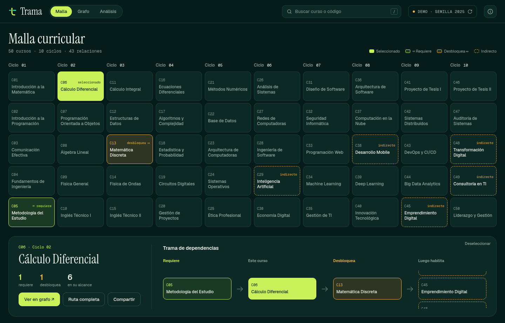
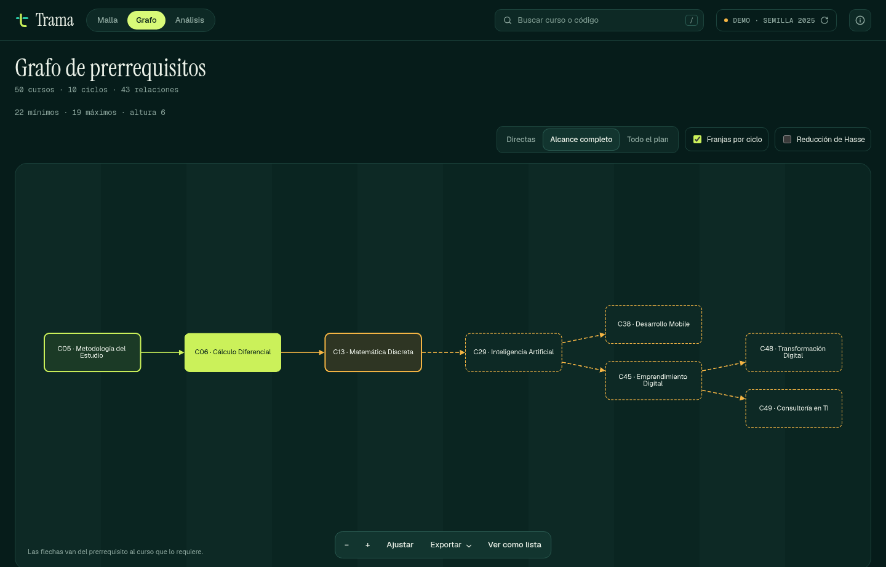
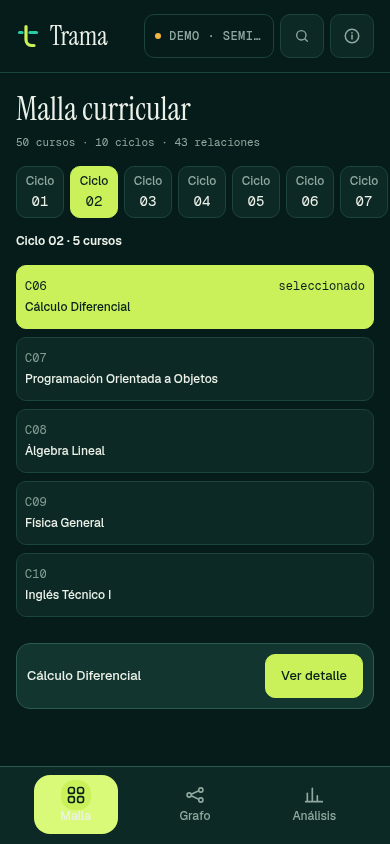

<div align="center">
  
  <h1>Trama</h1>
  <p><strong>See the curriculum. Follow the connections.</strong></p>
  <p>An interactive explorer for courses, prerequisites and the paths between them.</p>
  <p>
    <a href="https://trama.jahattrinidad.com"><strong>Explore the live app</strong></a>
    · <a href="#run-it-locally">Run locally</a>
    · <a href="#under-the-surface">Architecture</a>
    · <a href="CHANGELOG.md">Changelog</a>
  </p>
  <p>
    <a href="https://github.com/trinity-bytes/trama/tree/3.0.1"></a>
    <a href="LICENSE"></a>
    
  </p>
<a href="https://github.com/Gentleman-Programming/gentle-ai">
  
</a>
</div>

<a href="https://trama.jahattrinidad.com/?seed=2025&course=6">
  
</a>

**50 demo courses. 10 academic cycles. One connected view.** Select a course to see what comes before it, what it unlocks and how far its influence reaches. Switch between a curriculum grid, a directed graph and analysis without losing the underlying scenario.

> Trama is a demonstration tool, not an official academic plan. Initial relationships are generated randomly; an explicit seed makes a scenario reproducible. Screenshots use seed `2025` and show the real application, not design mockups.

## Three ways to explore

| View                                   | What it helps you answer                                                                                   |
| -------------------------------------- | ---------------------------------------------------------------------------------------------------------- |
| **Malla** · curriculum grid            | Where does a course belong, what does it require, and what can follow it?                                  |
| **Grafo** · dependency graph           | How do prerequisites connect, directly and indirectly? Explore the full plan or a selected course's reach. |
| **Análisis** · validation and ordering | Does the demo satisfy its rules? Which prerequisites does each course have? What is a valid course order?  |

Search by course name or code, inspect dependency paths, reproduce a scenario with its seed, and share a link to a selected course. The interface and course catalogue are in Spanish; search also works without accents.

<table>
  <tr>
    <th>Follow a dependency path</th>
    <th>Take it to a smaller screen</th>
  </tr>
  <tr>
    <td width="75%" valign="top">
      
      <p>Direction-aware relationships, zoom, fit, transitive reduction and a text alternative.</p>
    </td>
    <td width="25%" valign="top">
      
      <p>A cycle at a time, with bottom navigation and course details in a sheet.</p>
    </td>
  </tr>
</table>

### Keep the scenario, share the insight

- **Reproducible links:** a shared URL keeps the active seed and selected course. [Open an example](https://trama.jahattrinidad.com/?seed=2025&course=6).
- **Useful exports:** JSON and CSV from the current plan or analysis; PNG for the graph. Exports reflect regenerated data, not an old snapshot.
- **Clear relationship states:** selected, required, directly unlocked and indirectly reachable courses have distinct treatments.
- **Keyboard-aware controls:** native dialogs, focus restoration, live status announcements and a text alternative to the graph.

## Run it locally

No install step, bundler, backend or account. Clone the repository and serve its files:

```sh
git clone https://github.com/trinity-bytes/trama.git
cd trama
python3 -m http.server 8000
```

Open **[localhost:8000](http://localhost:8000)**. Use an HTTP server rather than opening `index.html` directly: the application uses native JavaScript modules.

For a repeatable scenario, open:

```text
http://localhost:8000/?seed=2025&course=6
```

A fresh visit without a seed generates a new scenario. Reloading a URL that already contains a seed reproduces it. Use the seed control to apply a specific seed or generate new relationships at random.

## Under the surface

Trama uses **HTML, CSS and native JavaScript modules**, with local **Cytoscape.js** and **Dagre** for the graph. The active interface does not depend on Bootstrap.

```text
js/
├── domain/        Course catalogue, generation, validation and graph algorithms
├── application/   Explicit state, actions and search selectors
├── ui/            App shell, views and presentation helpers
└── adapters/      Cytoscape integration
css/trama.css      Grove tokens, components and responsive layouts
tests/             Domain, state, presentation and browser regression checks
```

Relationships have a single canonical representation: directed edges from a prerequisite to the course that requires it. Views, analysis and exports derive from that data. Regeneration updates the shared state instead of leaving each screen to manage its own copy.

The Grove interface uses deep green surfaces, lime for selection and prerequisites, and amber for downstream relationships. Its fonts and visual assets are self-hosted.

<details>
<summary><strong>Design references and legacy source</strong></summary>

[PRODUCT.md](PRODUCT.md) records product constraints; [DESIGN.md](DESIGN.md) records the approved visual system. The Figma examples guided the interface, not the generator's output.

The former MVC source and Bootstrap vendor files remain as inactive historical references. They are not loaded by `index.html`. Domain regression tests compare seeded output against the original model implementation.

</details>

## Check the work

Run the deterministic regression tests with a current Node.js release:

```sh
node --test tests/domain/*.test.mjs tests/application/*.test.mjs tests/ui/*.test.mjs
```

The suite covers seeded generation, validation, graph relationships, state transitions, search and active-view exports.

<details>
<summary><strong>Browser checks</strong></summary>

With the local server running and Playwright available:

```sh
TRAMA_BASE_URL=http://localhost:8000 node tests/browser/flows.mjs
TRAMA_BASE_URL=http://localhost:8000 node tests/browser/mobile-accessibility.mjs
```

Set `PLAYWRIGHT_MODULE` to an existing Playwright module path when it is not resolvable as `playwright`. Set `CHROMIUM_PATH` when Chromium is not at `/usr/bin/chromium`.

The browser checks exercise desktop, tablet and mobile layouts, downloads, graph controls, dialog focus restoration and minimum mobile touch targets. Chromium and Playwright are development tools, not application dependencies.

Automated checks do not replace real screen-reader or physical-device testing. Implementation evidence and limitations are recorded in [the v3 work log](odd/tasks/trama-v3.md).

</details>

## Development and deployment

Features branch from `develop` and integrate through Git Flow AVH. Releases merge into `main` and back into `develop`. Commit messages follow **Conventional Commits in lowercase English**.

GitHub Pages publishes the repository root from **`main`** to **[trama.jahattrinidad.com](https://trama.jahattrinidad.com)** with HTTPS enforced. The root [`CNAME`](CNAME) retains the hostname; its DNS CNAME points to `trinity-bytes.github.io`, without a repository path. A tag alone does not deploy the site.

## License and credits

Built by **Trinity Bytes**. Released under the [MIT license](LICENSE).

Graph rendering: [Cytoscape.js](https://js.cytoscape.org/) and [Dagre](https://github.com/dagrejs/dagre). Typefaces: Geist, Geist Mono and Instrument Serif; their licenses are included in [`assets/trama/`](assets/trama/).
